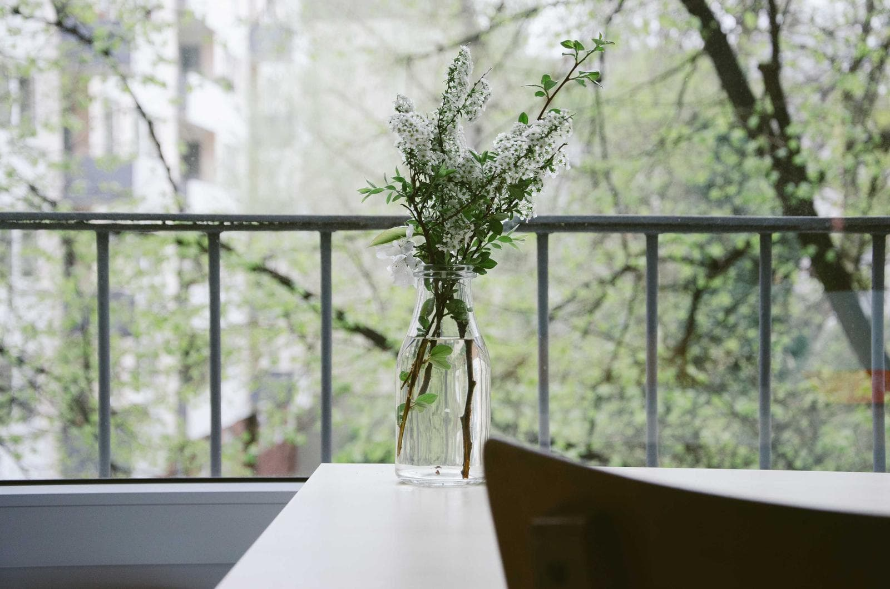
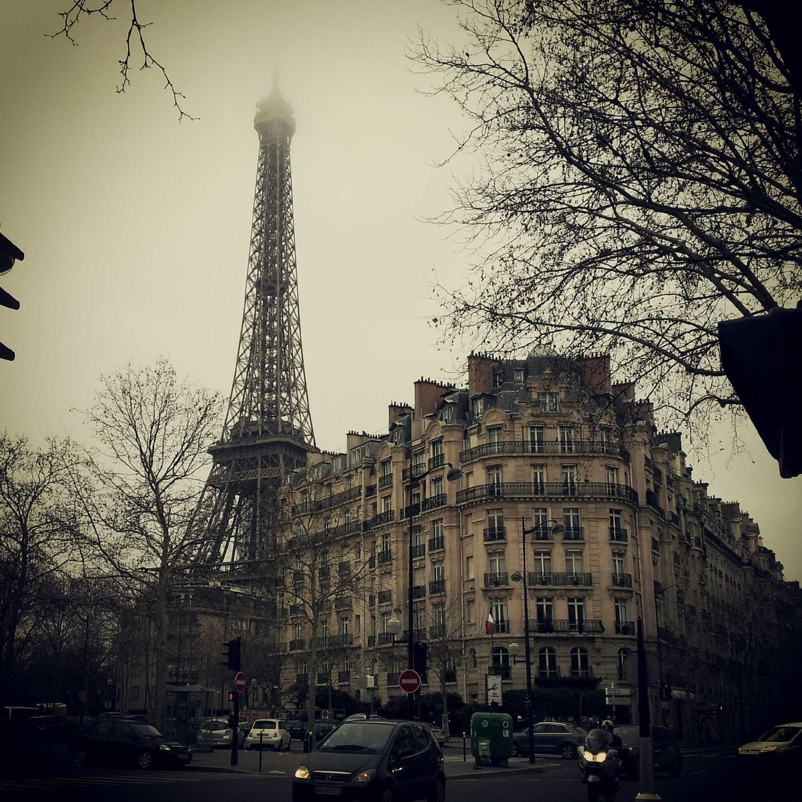

# A room of my own

The last box is unpacked. It contained cables, a chipped mug, and three books I thought I had lost.

For the first time, the room has no instructions for me. The desk is by the window. The lamp works. There is a plant on the sill that may or may not survive the summer.

  <figure class="memory-figure">
    
    <figcaption>The desk, finally clear</figcaption>
  </figure>
  <figure class="memory-figure">
    
    <figcaption>The view, if I lean out far enough</figcaption>
  </figure>

It is not a grand milestone, but it feels like one. I have made a place where the day can begin gently.
