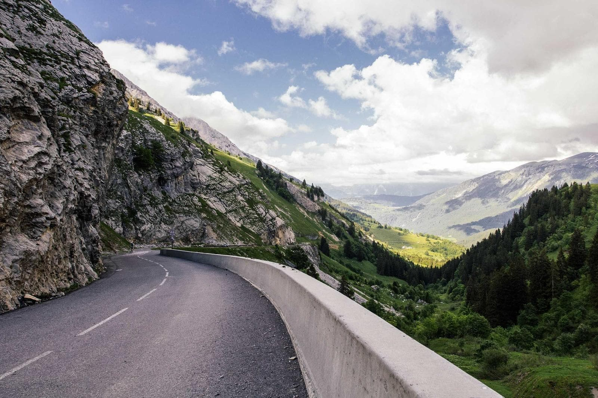
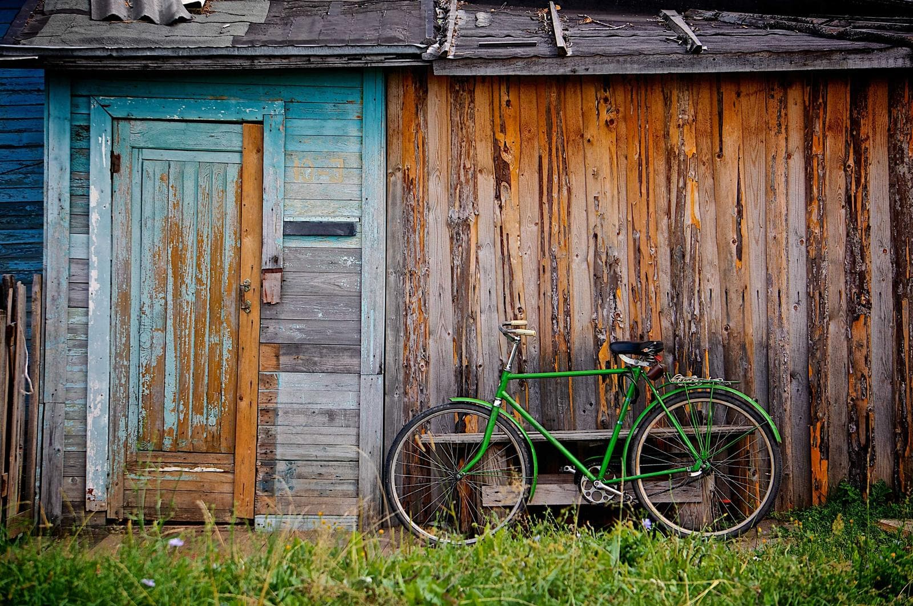
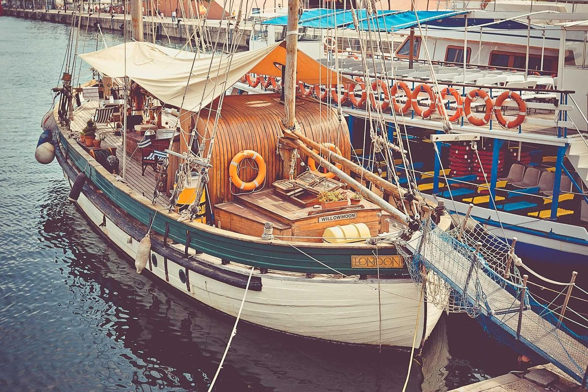
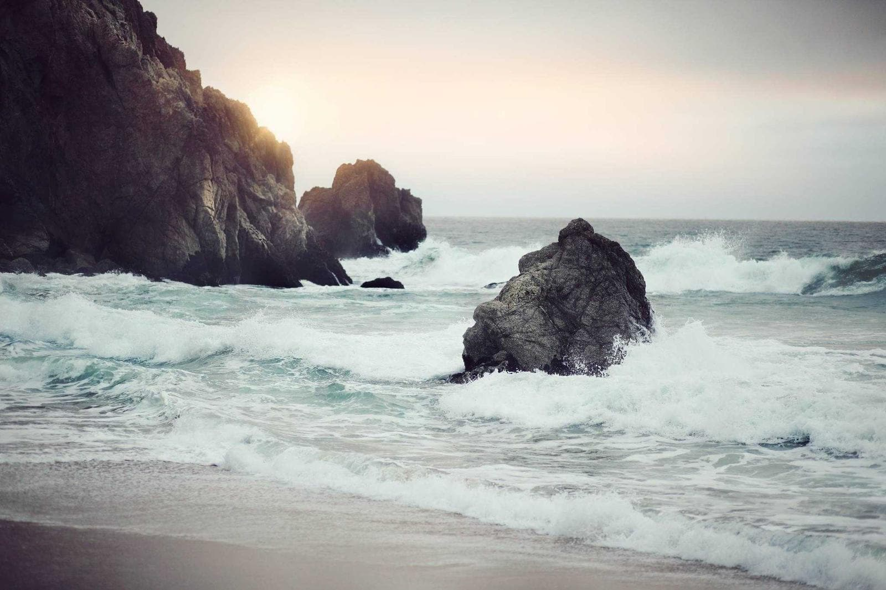

# The long way home

We left Marrakech before the heat arrived and took the road that looked least direct. Nobody argued. Someone put on a playlist none of us admitted to making.

By the time we reached the coast, the car was full of sand, orange peels, and the kind of conversation that only happens when no one is checking the time.

Essaouira was windy and blue. We ate lunch beside a weathered door, walked until our shoes filled with sand, and watched the fishing boats come in just before dusk.

  <figure class="memory-figure">
    
    <figcaption>Lunch, next to the blue door</figcaption>
  </figure>
  <figure class="memory-figure">
    
    <figcaption>The boats, just before dusk</figcaption>
  </figure>

I recorded a voice note on the sea wall so I wouldn't forget how it felt:

<audio controls src="./media/voice-note.m4a"></audio>

Some places are worth reaching slowly.
